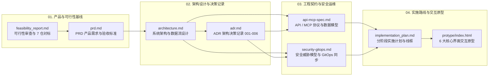

# Agent-Toolbox 工程文档中心

**Agent-Toolbox** 是面向多 AI Agent 协同开发者（全面适配 **Antigravity**、**Claude Code**、**Codex CLI**、**OpenCode**）的本地优先（Local-First）统一 MCP 网关、双层动态 Skill 运行时与三位一体向量知识库控制中心。

本目录提供从产品需求、系统架构、关键技术决策（ADR）、协议与数据模型契约到安全与 GitOps 同步设计的完整工程文档体系，并与 `protype/` 交互原型保持 100% 一致，是后续全栈编码与验收测试的单一事实来源（Single Source of Truth）。

---

## 1. 文档体系与阅读路线

---

## 2. 文档索引清单

| 分类 | 文档 | 核心内容 | 适用角色 |
| :--- | :--- | :--- | :--- |
| **产品与规划** | `docs/prd.md` | 6 大核心模块功能需求、宿主权限矩阵、页面状态表、量化指标与可测试验收标准（AC） | 产品经理、前后端研发、QA |
| **产品与规划** | `docs/feasibility_report.md` | GitHub 7 大标杆开源项目融合矩阵、四大宿主协议兼容评级与 4 大核心工程瓶颈解法 | 技术负责人、架构师 |
| **产品与规划** | `docs/implementation_plan.md` | 5 阶段分步落地路线、视觉设计规范与 6 大界面 ASCII 线框图 | 项目管理、全栈研发 |
| **架构与决策** | `docs/architecture.md` | Hub-and-Spoke 拓扑、Daemon + `stdio-proxy` 进程模型、5 级中间件流水线、双层 Skill 运行时与三位一体向量引擎 | 架构师、后端研发 |
| **架构与决策** | `docs/adr.md` | 6 篇核心工程决策记录（单守护进程、Lazy Discovery、双层 Skill、SHA-256 隔离、三位一体向量库、GitOps+Vault） | 架构师、核心贡献者 |
| **协议与安全** | `docs/api-mcp-spec.md` | 核心实体 ER 图、TypeScript/JSON Schema、唯一入口 JSON-RPC 2.0 规范（5 元工具 + 错误码）与控制台 REST/SSE API | 前后端研发、协议开发 |
| **协议与安全** | `docs/security-gitops.md` | STRIDE 威胁模型、Quarantine 状态机、HITL 审批时序、Output Redaction 规则、Local Vault 与 GitHub 零泄漏同步门禁 | 安全工程师、运维/研发 |

---

## 3. 核心术语对齐表（Glossary）

为保证文档、原型、代码与接口命名完全一致，项目内统一使用以下术语：

| 术语 | 英文标识 | 定义 |
| :--- | :--- | :--- |
| **唯一 MCP 入口** | `Unified MCP Entry` | 四个 AI Agent 宿主挂载的唯一本地端点（`stdio://agent-toolbox` 或 `http://127.0.0.1:3000/api/mcp/sse`） |
| **常驻暴露** | `Pinned` | 每轮对话均随 `tools/list` 下发的工具 Schema，零发现延迟但持续占用上下文 Token |
| **按需懒加载** | `Lazy` | 默认不进入 `tools/list`，通过语义发现与动态挂载按需暴露，实现约 89%–91% Token 瘦身 |
| **隔离审查区** | `Quarantine` | 当下游 MCP 工具 Schema 的 SHA-256 指纹与 `toolbox.lock.json` 不匹配时触发的自动拦截状态 |
| **人工审批锁** | `HITL` | Human-in-the-Loop，高危写/删工具执行前的同步暂停与人工确认门禁 |
| **双层 Skill** | `Dual-Layer Skill` | 同时包含第 1 层 `SKILL.md`（SOP 指令文本）与第 2 层关联可执行 MCP Tools 的动态热插拔能力包 |
| **三位一体向量检索** | `Trinity Search` | 单次自然语言查询同时命中私有文档分块（RAG）、跨宿主共享记忆（Memory）与推荐 Skill/工具（Smart Routing） |
| **本地密钥保险箱** | `Local Vault` | 仅在本地加密存储真实凭据，配置文件中统一使用 `vault://KEY_NAME` 符号引用以实现 GitHub 零泄漏同步 |
