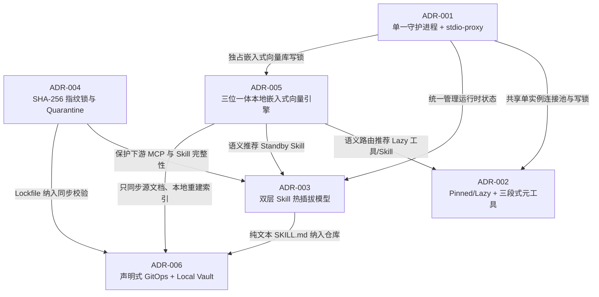

# Agent-Toolbox 架构决策记录集（ADR）

此目录记录 Agent-Toolbox 的架构决策及其背景、备选方案和工程后果。

各项决策面向目标架构。仓库中可运行的能力见[当前实现](../guides/current-implementation.md)。

## 决策索引

| 编号 | 决策 | 状态 |
| --- | --- | --- |
| [ADR-001](./001-single-daemon.md) | 单一守护进程与 stdio 代理 | Accepted |
| [ADR-002](./002-pinned-lazy-discovery.md) | Pinned / Lazy 工具暴露 | Accepted |
| [ADR-003](./003-dual-layer-skill.md) | 双层 Skill 动态挂载 | Accepted |
| [ADR-004](./004-schema-integrity.md) | Schema 指纹锁与 Quarantine | Accepted |
| [ADR-005](./005-local-vector-engine.md) | 本地向量引擎 | Accepted |
| [ADR-006](./006-gitops-and-vault.md) | 声明式 GitOps 与 Local Vault | Accepted |

## 决策依赖关系图

## 新增决策

每项决策使用一个 Markdown 文件，按现有编号顺延，例如 `007-简短主题.md`。正文记录状态、背景、决策和后果，在索引加入对应条目。新文件会自动出现在控制台的 ADR 分组。
