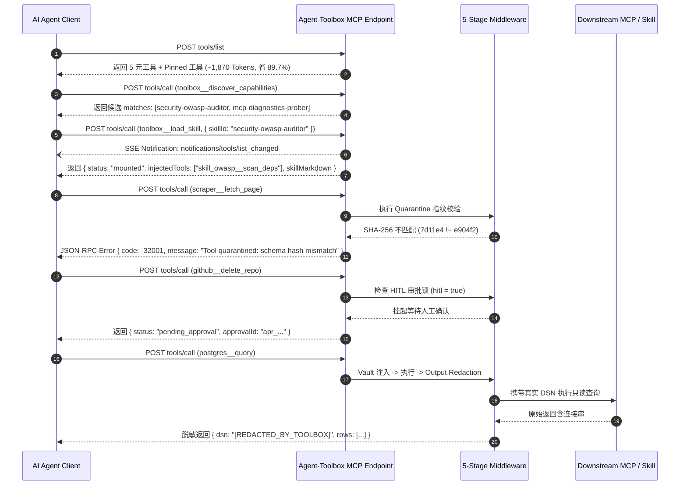
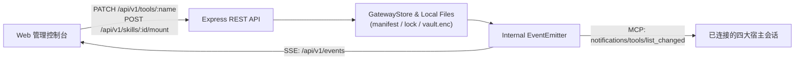

# Agent-Toolbox API 与 MCP 协议规范

本文档定义 **Agent-Toolbox** 的核心数据模型（ER 关系与 TypeScript/JSON Schema 契约）、唯一 MCP 入口 JSON-RPC 2.0 协议（含 5 大内置元工具与自定义错误码）以及 Web 管理控制台的 REST API 与 SSE 实时事件规范。

---

## 1. 核心数据模型与实体关系（ER 图）

```mermaid
erDiagram
    HOST_PROFILE {
        string id PK "antigravity / claude / codex / opencode"
        string name "宿主显示名称"
        boolean online "在线状态"
        int latencyMs "最近心跳延迟(ms)"
        enum scope "full | audit | min"
        timestamp lastSeenAt "最近活跃时间"
    }

    MIDDLEWARE_RULE {
        string id PK "vault | quarantine | hitl | redact | budget"
        string name "中文名称"
        string enName "英文标识"
        string description "规则说明"
        boolean enabled "开关状态"
        int order "执行序号 1-5"
    }

    MCP_SERVER {
        string id PK "如 github / scraper / postgres"
        string name "命名空间名称"
        enum protocol "stdio | sse | http"
        int latencyMs "心跳延迟(ms)"
        enum state "ok | quarantined | degraded | offline"
        string fingerprint "聚合 SHA-256 短码"
        string commandOrUrl "启动命令或远程端点"
    }

    MCP_TOOL {
        string name PK "namespace__tool_name"
        string serverId FK "所属 MCP_SERVER.id"
        string description "工具用途说明"
        int estimatedTokens "估算 Schema Token 占用"
        enum mode "pinned | lazy"
        boolean hitl "是否开启 HITL 人工审批"
        string fingerprint "当前运行态 SHA-256"
        string lockedFingerprint "Lockfile 基准 SHA-256"
    }

    QUARANTINE_RECORD {
        string id PK
        string serverId FK
        string toolName FK
        string expectedHash "sha256:7d11e4"
        string actualHash "sha256:e904f2"
        string baselineDescription "已签名基准描述"
        string mutatedDescription "检测到篡改后的描述"
        string riskReason "风险定性说明"
        enum status "pending | rolled_back | trusted"
        timestamp detectedAt
    }

    DUAL_LAYER_SKILL {
        string id PK "如 ast-code-refactor"
        string version "SemVer 版本号"
        string summary "一句话用途"
        int estimatedTokens "挂载后占用 Token"
        int callCount "累计调用次数"
        string successRate "成功率如 98.4%"
        boolean mounted "是否已热挂载"
        string mountedBy "挂载触发宿主"
        string fingerprint "SKILL.md + Tools SHA-256"
        string skillMarkdown "Layer 1 完整 SKILL.md 正文"
        json attachedTools "Layer 2 工具定义数组"
    }

    KNOWLEDGE_DOC {
        string id PK
        string filePath "如 docs/mcp-gateway-architecture.md"
        int chunkCount "分段总数"
        int embeddingDim "固定 1536"
        timestamp indexedAt
    }

    SHARED_MEMORY {
        string id PK
        string host "写入宿主名称"
        string topic "主题标签"
        string content "跨宿主共享经验正文"
        timestamp createdAt
    }

    VAULT_ENTRY {
        string key PK "正则 ^[A-Z0-9_]+$"
        string serviceName "绑定下游服务名"
        string maskedValue "仅首尾掩码如 ghp_****9a2f"
        boolean configured "是否已配置真实值"
        timestamp updatedAt
    }

    AUDIT_RPC_EVENT {
        string id PK
        string timestamp "HH:mm:ss"
        string host "发起宿主"
        string method "JSON-RPC method 或工具名"
        enum outcome "ok | blocked | pending_approval"
        int latencyMs
        json requestPayload
        json responsePayload
    }

    MCP_SERVER ||--o{ MCP_TOOL : "exposes"
    MCP_SERVER ||--o{ QUARANTINE_RECORD : "triggers"
    MCP_SERVER ||--o{ VAULT_ENTRY : "references"
    HOST_PROFILE ||--o{ SHARED_MEMORY : "writes"
    HOST_PROFILE ||--o{ AUDIT_RPC_EVENT : "invokes"
```



---

## 2. 核心 TypeScript 类型契约

```typescript
export type HostScope = 'full' | 'audit' | 'min';
export type ExposureMode = 'pinned' | 'lazy';
export type ServerState = 'ok' | 'quarantined' | 'degraded' | 'offline';
export type MiddlewareId = 'vault' | 'quarantine' | 'hitl' | 'redact' | 'budget';

export interface GatewaySummaryMetrics {
  fullExposureTokens: number;      // 默认 18170
  metaToolsTokens: number;         // 默认 1580
  currentExposureTokens: number;   // metaToolsTokens + sum(非隔离 pinned tools.tok)
  savedPercentage: number;         // 如 89.7
  savedTokensK: number;            // 如 16.3
  connectedServers: number;
  totalTools: number;
  mountedSkills: number;
  totalSkills: number;
  quarantinedCount: number;
  missingVaultKeys: number;
}

export interface ToolboxManifest {
  schemaVersion: '1.0';
  gateway: {
    exposureStrategy: 'hybrid-lazy' | 'pinned-all';
    secretRefs: string[];          // 仅允许 vault://<KEY_NAME>
  };
  hosts: Record<string, { scope: HostScope }>;
  mountedSkills: string[];
  servers: Array<{
    id: string;
    protocol: 'stdio' | 'sse' | 'http';
    defaultMode: ExposureMode;
  }>;
}

export interface ToolboxLockfile {
  schemaVersion: '1.0';
  generatedAt: string;
  tools: Record<string, string>;   // key: namespace__tool, value: sha256:<hex>
  skills: Record<string, string>;  // key: skillId, value: sha256:<hex>
}
```

---

## 3. 唯一 MCP 入口 JSON-RPC 2.0 协议规范

### 3.1 传输端点

- **Stdio 转发入口**：`npx agent-toolbox serve --stdio`（URI 标识：`stdio://agent-toolbox`）
- **Streamable HTTP / SSE 入口**：
  - SSE 事件流：`GET http://127.0.0.1:3000/api/mcp/sse`
  - JSON-RPC 上行：`POST http://127.0.0.1:3000/api/mcp/messages`

### 3.2 内置 6 大核心元工具契约

| 元工具名 | 输入参数（`arguments`） | 核心返回结构 | 说明 |
| :--- | :--- | :--- | :--- |
| `toolbox__discover_capabilities` | `{ query: string, topK?: number }` | `{ matches: Array<{ id, kind, score, mode, summary }> }` | 语义发现 Lazy 工具与 Standby Skill（L1 元数据），不膨胀上下文 |
| `toolbox__inspect_schema` | `{ toolName: string }` | `{ name, description, inputSchema, fingerprint, hitl }` | 三段式工作流第 2 步：按需查看单个 Lazy 工具完整 Schema |
| `toolbox__load_skill` | `{ skillId: string }` | `{ status: "mounted", bundleFingerprint, injectedTools, tokenBreakdown, availableFiles, skillMarkdownPreview }` | 热挂载目录包 Skill（L2），返回 L3 可按需读取资源清单并推送 `notifications/tools/list_changed` |
| `toolbox__read_skill_file` | `{ skillId: string, filePath: string }` | `{ skillId, path, category, tier, sha256, bundleFingerprint, content }` | L3 渐进式披露：按需读取 Skill 目录内 `references/*`、`templates/*`、`scripts/*` 等文件，内置路径穿越校验与 Output Redaction 脱敏 |
| `toolbox__unload_skill` | `{ skillId: string }` | `{ status: "unmounted", freedTokens: number }` | 动态卸载 Skill 并释放上下文 Token，推送 `list_changed` |
| `toolbox__search_knowledge` | `{ query: string, includeMemory?: boolean, includeRouting?: boolean }` | `{ docs: RagHit[], memories: MemoryHit[], routing: SkillSuggestion[], latencyMs: number }` | 一库三搜统一语义检索；配套 `toolbox__remember` 写入共享记忆 |

### 3.3 典型三段式发现与安全拦截时序



### 3.4 网关自定义 JSON-RPC 2.0 错误码表

| 错误码 | 常量名 | 触发场景 | 建议客户端/用户动作 |
| :--- | :--- | :--- | :--- |
| `-32001` | `ERR_TOOL_QUARANTINED` | 工具 Schema SHA-256 指纹与 `toolbox.lock.json` 失配 | 前往控制台「MCP 网关与安全」审查 Diff 并回滚或信任 |
| `-32002` | `ERR_HITL_REJECTED_OR_TIMEOUT` | HITL 高危审批被用户拒绝或超过等待超时（默认 120s） | 通知模型操作未获人工授权，禁止自动重试 |
| `-32003` | `ERR_HOST_SCOPE_FORBIDDEN` | 当前宿主权限作用域（`audit` / `min`）禁止调用写/删工具 | 在总览页提升宿主权限或切换至只读工具 |
| `-32004` | `ERR_VAULT_SECRET_MISSING` | 工具依赖的 `vault://KEY_NAME` 尚未在本地 Vault 配置 | 前往「GitHub 同步与密钥」补全缺失密钥 |
| `-32005` | `ERR_TOKEN_BUDGET_EXCEEDED` | 开启 Token 预算中间件且单轮累计 Token 超出阈值 | 卸载闲置 Skill 或调整工具为 `Lazy` 模式 |
| `-32006` | `ERR_DOWNSTREAM_UNAVAILABLE` | 下游 MCP 进程异常断开且重连次数耗尽 | 加载 `mcp-diagnostics-prober` 诊断下游连接 |

---

## 4. Web 管理控制台 REST API 与 SSE 契约

所有 REST 接口统一挂载于 `/api/v1/*`，响应采用标准 JSON 信封：`{ "ok": true, "data": ..., "meta": { "timestamp": "..." } }` 或 `{ "ok": false, "error": { "code": "...", "message": "..." } }`。

| 模块 | 方法与路径 | 请求体 / 查询参数 | 核心职责与副作用 |
| :--- | :--- | :--- | :--- |
| **全局状态** | `GET /api/v1/state` | 无 | 拉取总览指标、宿主列表、中间件、服务、Skill、知识库健康、Vault 掩码清单及同步状态 |
| **实时事件** | `GET /api/v1/events` | `Accept: text/event-stream` | 推送 `quarantine.detected`、`skill.changed`、`hitl.pending`、`vault.updated`、`sync.completed` |
| **宿主权限** | `PATCH /api/v1/hosts/:id/scope` | `{ "scope": "full" \| "audit" \| "min" }` | 更新宿主权限作用域并即时作用于对应会话 |
| **中间件** | `PATCH /api/v1/middleware/:id` | `{ "enabled": boolean }` | 启停 5 级安全中间件之一 |
| **MCP 服务** | `POST /api/v1/servers` | `{ name, protocol, commandOrUrl, defaultMode, secretRef? }` | 新增外部 MCP Server，拉取初始工具表并写入 Lockfile |
| **工具策略** | `PATCH /api/v1/tools/:toolName` | `{ "mode"?: "pinned"\|"lazy", "hitl"?: boolean }` | 切换工具常驻/懒加载或 HITL 审批锁，重算 Token 节省率 |
| **隔离处置** | `POST /api/v1/quarantine/:serverId/resolve` | `{ "action": "rollback" \| "trust" }` | 回滚至已签名基准版本，或重新签名更新 `toolbox.lock.json` |
| **演示篡改** | `POST /api/v1/quarantine/simulate` | `{ "serverId"?: "scraper" }` | 模拟下游 Rug-Pull 描述篡改以验证防投毒闭环 |
| **Skill 目录导入** | `GET /api/v1/skills/workspace-candidates` / `POST /api/v1/skills/import-directory` | `{ relativeDir, id?, version?, summary? }` | 安全扫描工作区 `skills/` 目录候选并一键导入整套 Skill 目录包（含 symlink 越界防护） |
| **Skill 管理** | `POST /api/v1/skills` / `PUT /api/v1/skills/:id` | `{ id, version?, summary?, skillMarkdown?, files?, sourceType? }` | 支持本地目录上传（`files[]`）或手动创建目录包，自动解析 Frontmatter 并计算整包 SHA-256 指纹 |
| **Skill 文件管理** | `PUT /api/v1/skills/:id/files` / `DELETE /api/v1/skills/:id/files?path=...` | `{ path, content }` | 在线新增、修改或删除 Skill 目录包内子文件（禁止删除 `SKILL.md`），即时重算整包 SHA-256 指纹 |
| **热插拔** | `POST /api/v1/skills/:id/mount` / `unmount` | `{ "host"?: string }` | 热挂载或卸载目录包 Skill 并广播 `list_changed` |
| **统一检索** | `POST /api/v1/kb/search` | `{ "query": string }` | 执行一库三搜，返回 `docs`、`memories`、`routing` 及耗时 |
| **知识/记忆** | `POST /api/v1/kb/docs` / `POST /api/v1/kb/memories` / `DELETE /api/v1/kb/memories/:id` | 文档标题/正文或记忆对象 | 文档自动分块向量化入库、增删跨宿主记忆 |
| **索引重建** | `POST /api/v1/kb/rebuild` | 无 | 触发双缓冲向量索引重建并返回最新健康报告 |
| **本地密钥** | `PUT /api/v1/vault/:key` | `{ "value": string, "serviceName"?: string }` | 校验 `^[A-Z0-9_]+$`，本地加密落盘并返回掩码（永不回传明文） |
| **GitHub 同步** | `GET /api/v1/sync/preflight` / `POST /api/v1/sync/pull` / `POST /api/v1/sync/push` | 可选 `{ "commitMessage": string }` | 执行 3 项推送前安全门禁检查，门禁未过返回 `409 Conflict` |
| **协议沙箱** | `POST /api/v1/sandbox/rpc` | `{ "host": string, "stepIndex": number }` 或自定义 JSON-RPC 载荷 | 按当前真实中间件与权限配置模拟执行并返回标准报文与审计日志 |

---

## 5. REST + SSE 状态闭环流转图


