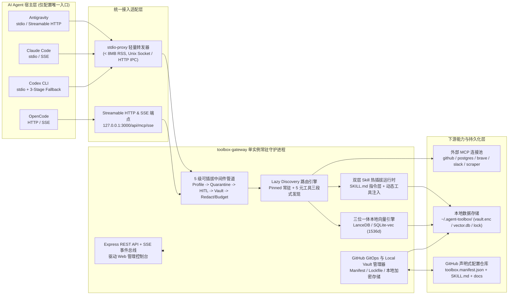
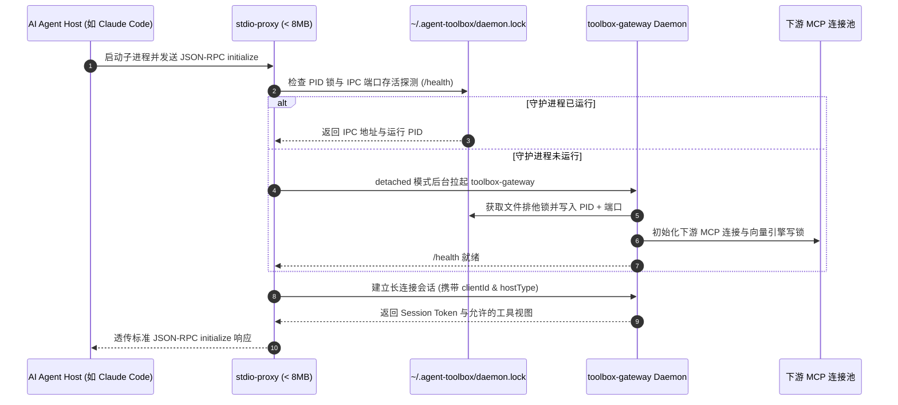
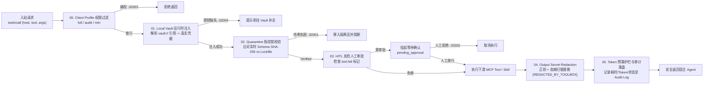
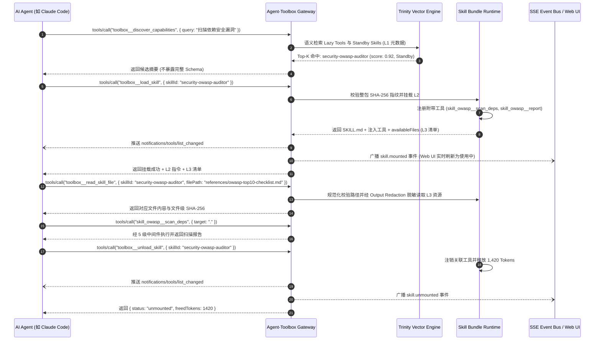
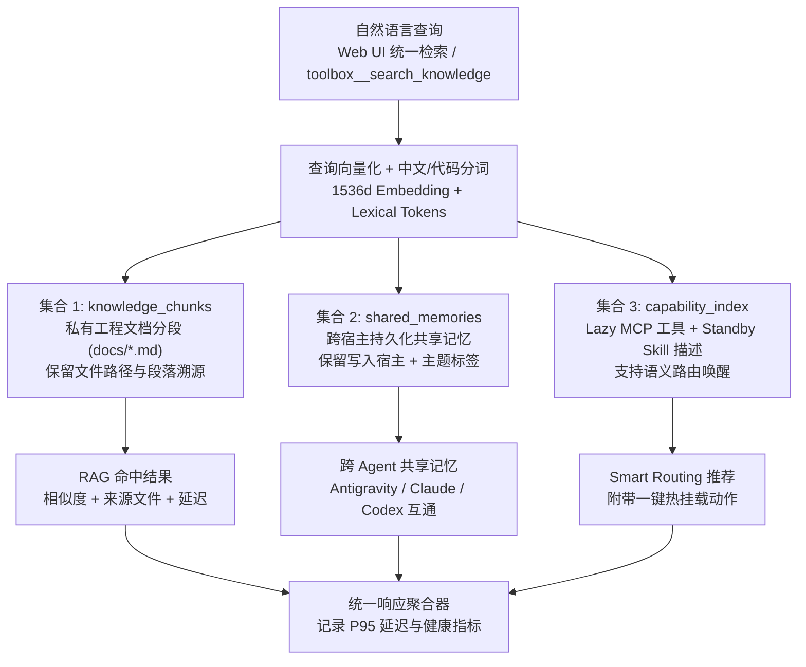

# Agent-Toolbox 系统架构设计文档

本文档定义 **Agent-Toolbox** 的总体分层架构、进程守护模型、核心子系统职责边界、5 级可插拔中间件管道、双层 Skill 动态运行时以及三位一体本地向量引擎的工程实现蓝图。

---

## 1. 总体系统架构（Hub-and-Spoke 多路复用）

Agent-Toolbox 采用 **Local-First 单守护进程（Daemon）+ 轻量级代理转发桥（Proxy Bridge）** 架构。四大 AI 宿主均只配置并连接唯一入口，彻底消除多宿主并发拉起重复子进程与本地数据库写锁冲突。

---

## 2. 进程模型与多宿主并发控制

### 2.1 单实例守护进程锁与按需拉起

当任意宿主首次执行 `npx agent-toolbox serve --stdio` 时，`stdio-proxy` 不会直接孵化下游 MCP 服务，而是按以下流程复用全局唯一的 `toolbox-gateway` 守护进程：

### 2.2 并发写锁与会话隔离策略

- **单写多读（SWMR）向量存储**：本地嵌入式向量库（SQLite-vec / LanceDB）由守护进程独占写句柄，所有写入操作（文档分块入库、跨宿主记忆 `toolbox__remember`、索引重建）进入内部串行任务队列，避免多宿主同时写入导致数据库损坏。
- **会话级工具视图（Session View）**：虽然下游连接池全局共享，但不同宿主拥有独立的 `ClientProfile`（`full` / `audit` / `min`）与会话挂载上下文，调用 `tools/list` 时网关按当前宿主的权限作用域动态裁剪可见工具集合。

---

## 3. 核心子系统分层与职责边界

### 3.1 六大核心子系统职责表

| 子系统 | 核心职责 | 关键数据结构 / 持久化介质 | 故障隔离策略 |
| :--- | :--- | :--- | :--- |
| **1. Gateway Router & Pool** | 管理下游 `stdio / sse / http` MCP 连接池、心跳探活、指数退避重连及 `<namespace>__<tool>` 前缀隔离路由 | `McpServerRecord`、`McpToolRecord`（内存态 + `toolbox.manifest.json`） | 单下游进程崩溃仅标记该命名空间为 `degraded`，不影响其余服务与网关存活 |
| **2. Lazy Discovery Engine** | 计算常驻 Token 占用，默认仅暴露 `Pinned` 工具 + 5 个内置元工具，提供 `Discover → Inspect → Run/Mount` 三段式调度 | `ExposurePolicy`、Token 估算缓存表 | 当宿主不支持 `notifications/tools/list_changed` 时无缝退化为代理执行 |
| **3. Middleware Pipeline** | 统一拦截所有入站 `tools/call` 与出站结果，按固定顺序执行权限、指纹、HITL、密钥注入、脱敏与预算检查 | `MiddlewareConfig[]`、`AuditRpcEvent[]` | 中间件采用短路拒绝机制（Fail-Closed），安全校验失败一律阻断向下游透传 |
| **4. Dual-Layer Skill Runtime** | 管理 `SKILL.md`（SOP 层）与配套可执行工具（Tool 层）的生命周期，负责 SHA-256 指纹重算与热挂载事件广播 | `DualLayerSkill`、`skills/<id>/SKILL.md` | 卸载立即回收工具注册并通知宿主，防止上下文残留污染 |
| **5. Trinity Vector Engine** | 将文档分块、跨宿主记忆、Lazy 工具与 Skill 描述统一编码为 `1536d` 向量，执行混合语义 + 关键词检索 | `VectorChunk`、`SharedMemory`、`VectorHealthStats` | 向量模型离线或索引异常时降级至本地 BM25 / 词法匹配，保证可用性 |
| **6. GitOps & Local Vault** | 维护声明式配置与指纹锁的 Git 同步、推送前 3 项安全门禁检查，以及本地 AES-256-GCM / Keychain 密钥保险箱 | `toolbox.manifest.json`、`toolbox.lock.json`、`vault.enc` | 严禁明文凭据写入任何可追踪文件；缺密钥时精准拦截对应下游服务而非崩溃 |

---

## 4. 5 级可插拔中间件管道架构

每次 AI Agent 发起 `tools/call` 请求，均依次穿过入站校验链与出站净化链。各环节均可在总览控制台开关（除硬性权限与命名空间校验外），并实时体现在沙箱与真实网关流量中。

---

## 5. 目录包 Skill 与三级渐进式动态运行时

传统跨 Agent 技能管理依赖在 `~/.claude/skills`、`~/.codex/` 等目录创建大量文件软链接，且单文件模型无法承载复杂脚本、参考规范与输出模板。Agent-Toolbox 遵循开放 Agent Skills 目录包规范，将每个 Skill 抽象为受网关托管的**目录包运行时单元**（`<skill-id>/` 包含必需的 `SKILL.md` 以及可选的 `scripts/`、`references/`、`templates/`、`assets/`、`README.md`），并采用 **L1 / L2 / L3 三级渐进式披露**与**整包 SHA-256 指纹锁**：

- **L1 路由元数据（~60–100 Tokens）**：待命态仅向向量路由索引暴露 `name` 与 `description`。
- **L2 入口指令 + 附带工具**：调用 `toolbox__load_skill` 挂载时注入 `SKILL.md` 正文与附带 MCP 工具，同时返回 L3 可用资源清单。
- **L3 按需资源（0 预载 Tokens）**：`references/*`、`templates/*`、`scripts/*`、`assets/*` 在执行阶段由 Agent 按需调用 `toolbox__read_skill_file` 读取（受路径穿越校验与 Output Redaction 保护）；`README.md` 标记为仅人类阅读（`injectToModel: false`，恒占 0 Token）。
- **整包 SHA-256 指纹**：按排序后的全部相对路径与单文件 SHA-256 联合计算，修改任何子脚本或模板均会触发指纹变化并同步写入 `toolbox.lock.json`。

---

## 6. 三位一体向量引擎架构（Trinity Vector Engine）

单一本地向量引擎同时承载三大逻辑集合（Collection），所有向量统一规范为 `1536d` 浮点维度，实现“一次自然语言查询，三路并发召回与重排”：

### 6.1 向量库健康体检与自愈机制

- **维度一致性检查**：校验全部已入库记录是否严格满足 `dim === 1536`，发现混杂维度自动标黄告警并提示重建索引。
- **孤立分段清理（Orphan Detection）**：比对源文档列表与向量块外键，确保 `orphanChunks === 0`；文档删除或 Git Pull 更新时自动执行增量重新分块。
- **重建索引流水线**：采用“双缓冲临时表构建 → 原子指针切换”策略，重建期间检索服务仍可读旧索引，零停机切换。

---

## 7. Web 管理控制台与后端通信架构

Web 管理控制台与 `toolbox-gateway` 之间采用 **REST API（写操作与按需查询）+ SSE（实时状态推送）** 协同模式：

1. **状态单一数据源**：后端 `GatewayStore` 持有全部真实运行态（宿主连接、中间件开关、MCP 服务与工具策略、Quarantine 记录、Skill 挂载状态、向量健康度、Vault 掩码清单及审计流水）。
2. **变更闭环联动**：任何通过控制台触发的操作（如切换 `Pinned/Lazy`、回滚 Quarantine、补全 Vault 密钥、挂载 Skill）立即持久化至本地状态并广播至网关引擎，紧接着在 JSON-RPC 沙箱或真实宿主连接中立即生效。
3. **优雅容错**：所有 API 返回统一信封结构与明确中文错误文案，前端渲染加载骨架、空态与错误恢复操作，绝不出现无反馈的静默失败。
