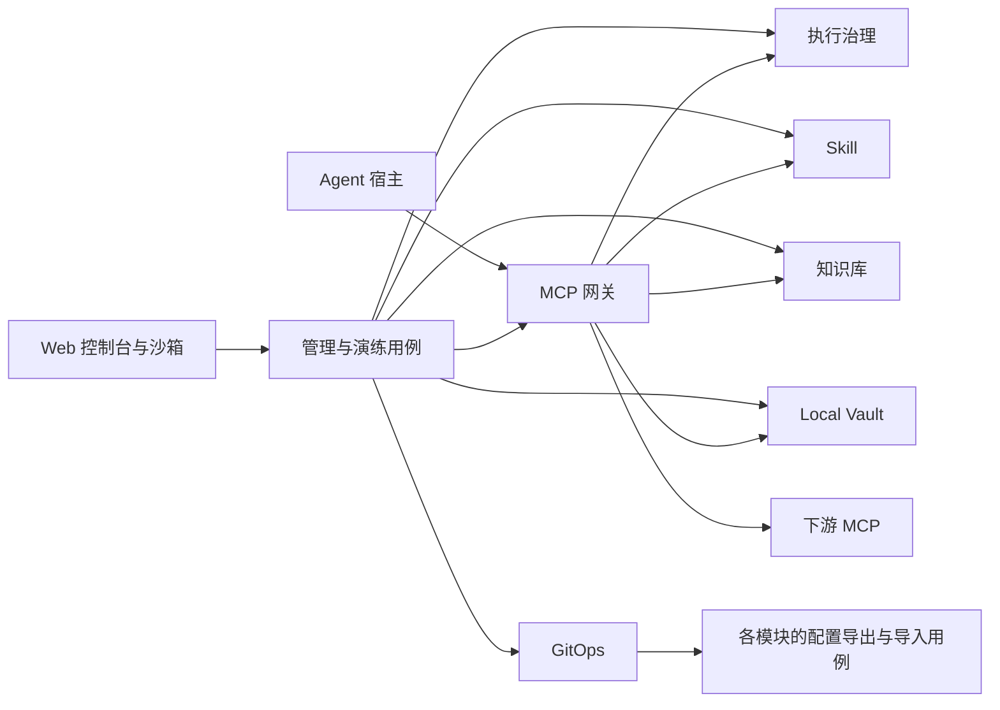
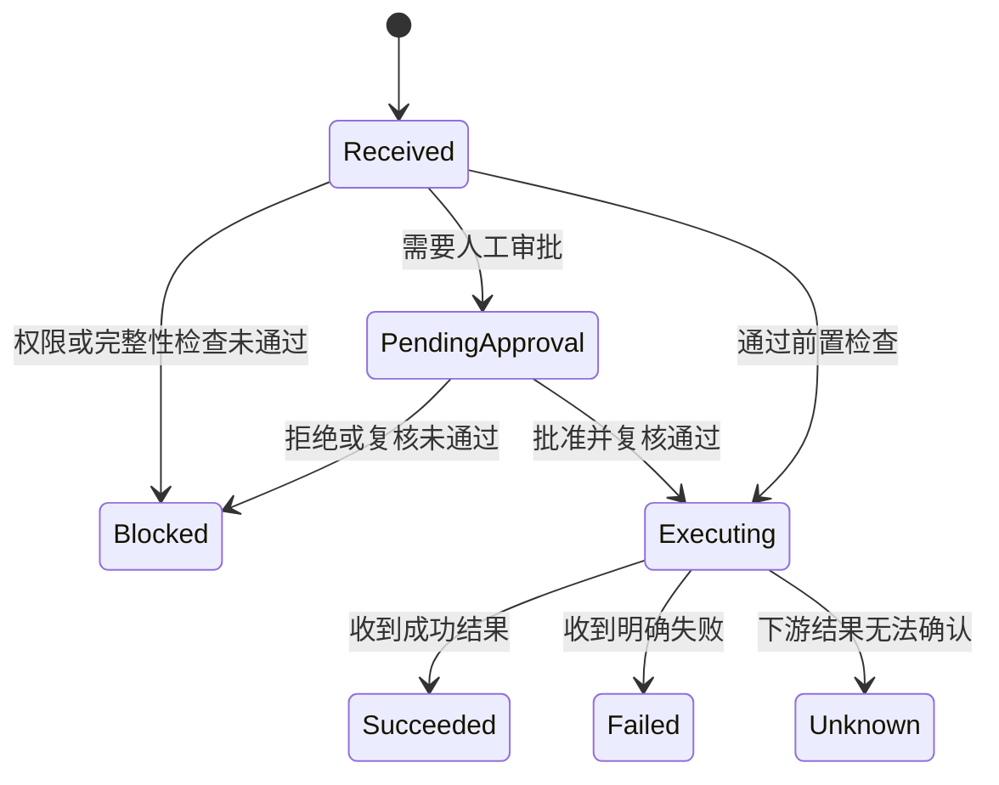

# 功能模块与领域模型

本提案采用本地优先的模块化单体。单守护进程复用下游 MCP 连接，领域模块分别管理自己的业务状态，React 控制台、MCP 宿主和 JSON-RPC 沙箱通过各自的入口使用这些模块。组织方式沿用产品需求和既有架构决策，文末列出需要验证的产品语义。[产品需求](../product/prd.md) · [系统架构](./architecture.md) · [ADR 索引](../adr/README.md)

## 功能模块

将权限下的能力发现、Skill 挂载和工具执行作为核心流程。知识索引提供召回，Vault 和 GitOps 分别处理凭据与跨设备配置。六个页面按用户任务组合这些模块。

| 模块 | 拥有的数据与规则 | 对外用例 | 产品入口 |
| --- | --- | --- | --- |
| **MCP 网关** | 宿主配置、宿主会话、MCP 服务注册、工具目录和工具调用的生命周期。在模块内管理会话工具视图、命名空间与下游连接复用。 | 建立会话、注册服务、列出或发现能力、检查 Schema、执行工具调用 | 总览、MCP 网关、JSON-RPC 沙箱 |
| **执行治理** | 宿主授权规则、工具暴露策略、可信 Schema 基准、隔离记录、人工审批及预算配置。负责产生允许、拒绝或待审批的决定。 | 评估可见性与调用权限、处置隔离、决定审批、过滤出站结果 | 总览、MCP 网关、JSON-RPC 沙箱 |
| **Skill** | Skill 包、包修订及文件、关联工具、会话挂载。负责 `SKILL.md` 完整性、指令与资源的分阶段披露。 | 导入和编辑包、挂载与卸载、读取当前挂载版本的资源 | Skill 中心、MCP 元工具、知识库推荐 |
| **知识库** | 知识源、共享记忆、分段与索引。能力索引由网关和 Skill 的描述构建。 | 收录源文档、读写记忆、统一检索、重建索引 | 知识库、MCP 元工具 |
| **Local Vault** | 密钥值、可用性和轮换状态。配置和日志使用引用或掩码。 | 设置与轮换密钥、检查引用是否就绪、为已授权的连接解析密钥 | Vault、下游连接配置、同步预检 |
| **GitOps** | 同步目标、同步进度、导出版本与最近应用的版本。读取各模块提供的配置，编排导出与导入。 | 生成清单与指纹锁、预检、推送、验证并应用拉取的版本 | GitHub 同步 |

总览从各模块读取状态，组装告警和指标。沙箱执行同一套用例，使用独立的演示状态和模拟下游。审计记录工具调用及治理决定，控制台按一次调用的标识关联报文、决定和结果。工程文档浏览继续由文档入口从工作区读取。

## 模块之间如何协作



- **网关调用链**统一处理宿主身份、路由和调用结果。执行治理给出针对会话、工具及当前版本的判定，网关负责向下游执行。需要候选排序时，网关读取知识库的检索结果，再按会话权限和隔离状态裁剪。
- **Skill 调用链**以 `SessionId` 和 `SkillId` 读取挂载，以修订标识定位文件。包和工具目录变更后，更新能力索引与受影响会话的视图。支持动态刷新时通知对应会话，代理调用沿用同一套治理。
- **同步链路**根据导出版本生成清单和预检结果。实际推送使用该版本的内容，配置更新后重新预检。拉取先校验清单与指纹，再应用配置，缺失密钥通过引用状态提示，知识索引按内容变化重建。
- **一致性**由拥有数据的模块维护。跨模块传递稳定标识、查询结果和已经生效的变更。索引与仪表盘允许晚于业务写入更新，工具执行和检索结果的权限过滤使用当前授权。

演进时可按业务职责放置代码，模块向其他调用方公开用例和必要的查询。连接池、分块策略、加密和索引实现留在所属模块内。

```text
src/server/
  gateway/     宿主会话、能力目录、路由与调用生命周期
  policy/      授权、可信基准、隔离与审批
  skills/      包与修订、资源与会话挂载
  knowledge/   知识源、共享记忆与检索
  vault/       凭据与引用解析
  sync/        配置导入导出与同步流程
```

## 核心对象与规则

| 对象 | 标识与关系 | 一致性规则 |
| --- | --- | --- |
| **宿主配置 / 宿主会话** | 一个 `HostId` 关联零到多个 `SessionId`。宿主类型、显示名称和权限范围分别表达。 | 会话绑定已验证的宿主身份。权限收紧后，已有会话的下一次查询和执行使用最新权限。连接结束时释放会话挂载。 |
| **MCP 服务 / 工具定义** | `ServerId` 稳定标识注册记录。工具以服务标识与下游名称共同定位，`namespace__tool` 是对外名称。工具定义随观测到的 Schema 修订变化。 | 命名空间唯一。工具可见性结合宿主权限、Pinned / Lazy、服务状态和挂载状态计算。执行前仍按当前状态授权。 |
| **可信 Schema 基准 / 隔离记录** | 一份基准记录某一工具已信任的规范化 Schema 指纹。隔离记录关联基准与观测版本。 | 接受变更时只确认审查过的版本。若观测版本已变化，重新提交审查。继续按现有 ADR 的服务级隔离范围阻断执行。 |
| **工具调用 / 人工审批** | 一笔 `InvocationId` 关联会话、工具修订和经确认的参数。审批绑定该笔调用。 | 调用进入待审批时暂停执行。批准后复核权限与工具版本，再尝试执行一次。下游响应不明时记录结果未知，自动重试需有下游幂等保证。 |
| **Skill 包 / 包修订 / Skill 挂载** | `SkillId` 标识包，版本或完整指纹标识修订。每个会话对同一 Skill 至多一个有效挂载。 | 挂载关联已校验的修订，编辑产生新修订。生效中的挂载通过显式更新切换版本，停用或失信的修订按治理决定撤下。 |
| **知识源 / 共享记忆** | 知识源以稳定标识关联来源和修订。分段可从修订重建。记忆以 `MemoryId` 标识，记录写入宿主与可见范围。 | 项目记忆携带 `ProjectId` 并按项目隔离。查询按当前范围与权限返回结果。删除或限制访问的内容立即在结果端排除，索引随后清理。 |
| **密钥引用 / 同步版本** | 引用在设备间保持稳定，各设备分别补齐密钥。同步版本关联一份清单、一份指纹锁，以及按规则纳入的源文件。 | 密钥明文只在需要的下游连接中使用。持久化配置与重建索引所需的源内容可按策略同步。 |

### 工具调用的状态



Pinned / Lazy 只决定呈现时机。发现、检查和执行都使用会话权限。执行后的结果和审计数据按各自的脱敏规则输出。审计应能区分前置拒绝、审批拒绝、明确失败和结果未知。

## 数据如何保存

| 生命周期 | 数据 |
| --- | --- |
| 持久配置与源内容 | 宿主和服务配置、工具策略、可信基准、Skill 包、知识源及其出处、明确保存的默认挂载设置、同步目标 |
| 本地业务记录 | 共享记忆、密钥、隔离处置、审批决定和审计记录 |
| 会话运行态 | 活跃连接、会话挂载、待执行续点。会话结束后释放，未完成操作的治理记录按本地规则保留。 |
| 派生数据 | 工具视图、Token 估算、搜索索引、健康度、仪表盘快照。由持久记录与当前运行态重算。 |

### 需要验证的产品场景

| 场景 | 提案中的默认行为 |
| --- | --- |
| Claude Code 有两个会话，其中一个临时挂载 Skill | 该挂载只改变发起会话的工具视图。设为跨设备默认挂载是单独的配置操作。PRD 中“挂载会更新清单”需要明确指向默认配置操作。 |
| 操作者批准了调用，但审批等待期间权限收紧或工具描述发生变化 | 当前调用停止，审计记录复核结果。新的调用按当前权限及基准重新进入治理。 |
| 两个项目都写入主题相同的记忆 | 在各自项目范围查找，按策略同时提供全局记忆。当前安全设计包含 `memories.jsonl`，提案采用显式选择后同步，待确认跨设备共享范围。[安全与 GitOps 设计](../reference/security-gitops.md) |
| 用户轮换密钥，或拉取另一个设备的配置 | 清单中的密钥引用保持不变。设备独立解析密钥，缺失项只影响依赖该引用的操作。 |

## 从原型迁移

当前 `GatewayStore` 同时承载样例数据、配置、调用分支和读模型。`DualLayerSkill.mounted` / `mountedBy` 代表全局演示状态，`SharedMemory.scope` 只有范围标签，`GatewayStateSnapshot` 是聚合后的控制台数据。真实接入前，按下列顺序迁移并通过现有入口验证。[当前实现](../guides/current-implementation.md)

1. **网关与执行治理**。以一次只读工具调用贯穿会话识别、候选解析、策略判定、模拟下游和结果投影。再接入隔离和审批。在同一入口验证拒绝请求的下游调用次数为零、批准的请求基于当前版本完成。
2. **Skill 与会话工具视图**。将包修订和挂载作为独立对象。连接两个会话，验证挂载和卸载只改变目标会话，包编辑后仍可读取已挂载的合法修订。
3. **知识库**。确定知识源和记忆的归属后，逐步替换检索实现。验证项目隔离、删除生效及索引重建，再接入向量适配。
4. **Vault 与 GitOps**。接入本地凭据存储后，从各模块导出可移植配置。用两套本地工作目录验证推送前检查、重复拉取、缺失密钥提示和索引恢复。

先在 `src/server/` 按业务职责抽取模块，沿用现有路由和 DTO 作为适配入口。在接入真实下游、Git 或本地持久存储时，引入对应的外部接口。控制台快照继续组装各模块的查询结果。
