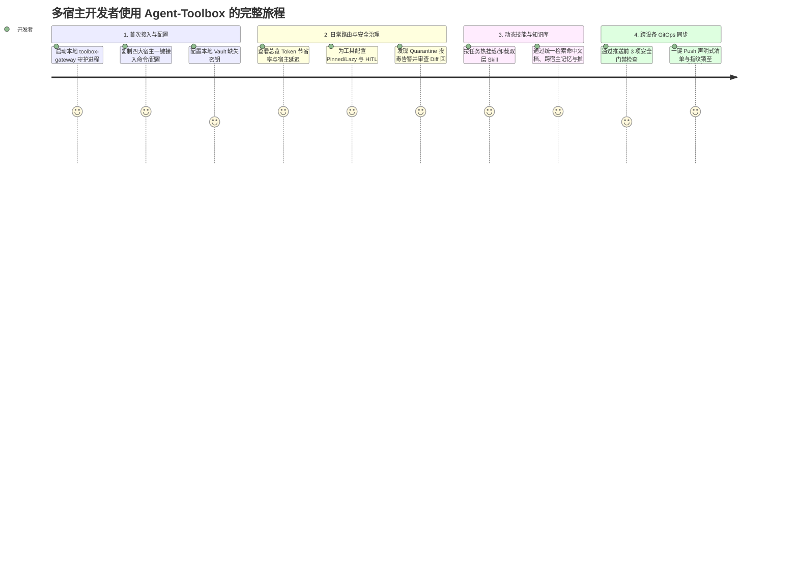

# Agent-Toolbox 产品需求文档（PRD）

- **文档版本**：`v1.0.0`（目标需求与验收基线）
- **目标平台**：本地常驻守护网关（Node.js / TypeScript）+ Web 管理控制台（Desktop 1440px 基准，完整适配 360px–1920px 响应式断点）
- **目标宿主**：`Antigravity`、`Claude Code`、`Codex CLI`、`OpenCode`

实现进度见[当前实现](../guides/current-implementation.md)。界面参考见[实施计划](./implementation_plan.md)和[交互原型](../../prototype/index.html)。

---

## 1. 产品背景与核心目标

### 1.1 核心痛点

现代 AI 辅助开发工程师往往同时使用多个编程 Agent（Antigravity、Claude Code、Codex CLI、OpenCode），并接入 5–15 个外部 MCP Server 及若干领域 Skill。现行分散接入模式面临四大痛点：

1. **上下文 Token 爆炸**：全量暴露下游工具 Schema（如 5 服务 14+ 工具乃至百级工具）单轮消耗高达 `18,170+` Tokens，拉高首字延迟（TTFT）并导致模型选错工具。
2. **进程风暴与数据孤岛**：4 个宿主各自独立拉起子 MCP 进程，造成几十个冗余子进程及本地嵌入式向量库写锁冲突；且 Claude Code 积累的经验无法被 Codex CLI 或 Antigravity 复用。
3. **供应链投毒与误操作风险**：`npx -y` 动态拉取的第三方 MCP Server 可能静默修改工具描述实施 Prompt Injection（Rug-Pull 攻击）；危险删除操作缺乏人工确认；返回结果中的密钥可能直接泄露给 LLM。
4. **多设备同步困难**：手动在各编辑器目录维护 `.claude/skills` 软链接与明文 JSON 配置极易泄漏 API Token，且难以在多台开发机间一致恢复。

### 1.2 量化成功指标（KPI）

| 指标维度 | 基准值（无网关） | 目标值（Agent-Toolbox） | 验收方式 |
| :--- | :--- | :--- | :--- |
| 单轮默认上下文 Token 占用 | `~18,170 Tokens` | `≤ 1,870 Tokens`（节省 **89.7%–91.3%**） | 沙箱 `tools/list` 对比计算 |
| 宿主接入配置复杂度 | 每宿主维护 N 个 MCP 配置 | 每宿主仅挂载 **1 个** 唯一 MCP 入口 | 一键配置生成器验证 |
| 第三方工具静默篡改拦截率 | `0%`（无校验） | **100%**（SHA-256 失配立即进入 Quarantine） | 模拟 Rug-Pull 篡改测试 |
| 向量语义检索 P95 延迟 | N/A | `≤ 15ms`（原型基线 `11ms`，召回率 `≥ 98%`） | 知识库 RAG 检索压测 |
| GitHub 同步明文密钥泄露数 | 高风险 | **0 条**（强制 `vault://` 引用与推送前门禁） | 推送前 3 项安全检查拦截 |

---

## 2. 用户画像与核心旅程

### 2.1 目标用户

- **多 Agent 协同全栈工程师**：日常在 IDE（Antigravity）、终端（Claude Code / Codex CLI）与轻量客户端（OpenCode）间切换，需要统一工具链、共享工程记忆与安全可控的执行边界。
- **团队研发效能 / 平台负责人**：希望将标准 MCP 集合、审计规则、团队 SOP（`SKILL.md`）与架构文档通过 GitHub 仓库分发给全员，同时保证个人 API Key 绝不入库。

### 2.2 端到端用户核心旅程

---

## 3. 功能架构总览

```mermaid
flowchart TB
    Shell["全局工作台外壳<br/>顶部三区导航 + 左侧锚点/宿主状态栏 + 对话框/Toast"]

    Shell --> M1["M1. 总览驾驶舱<br/>Overview"]
    Shell --> M2["M2. MCP 网关与安全<br/>Gateway & Quarantine"]
    Shell --> M3["M3. 双层 Skill 中心<br/>Skill Hub"]
    Shell --> M4["M4. 知识库 RAG 与记忆<br/>Trinity Vector KB"]
    Shell --> M5["M5. GitHub 同步与 Vault<br/>GitOps & Secrets"]
    Shell --> M6["M6. JSON-RPC 沙箱与报告<br/>Sandbox & Audit Report"]

    M1 --> M1A["待处理告警横幅<br/>隔离/缺失密钥"]
    M1 --> M1B["4 项核心 KPI 卡片<br/>可点击下钻"]
    M1 --> M1C["Hub-and-Spoke 拓扑<br/>5 级中间件实时开关"]
    M1 --> M1D["宿主权限作用域<br/>四大宿主配置生成器"]

    M2 --> M2A["Quarantine 审查面板<br/>Diff 比对 / 回滚 / 信任"]
    M2 --> M2B["下游 MCP 服务与工具表<br/>Pinned/Lazy · HITL · 指纹"]
    M2 --> M2C["接入外部 MCP / 模拟篡改"]

    M3 --> M3A["Skill 分组筛选列表<br/>全部 / 使用中 / 待命"]
    M3 --> M3B["双层详情检视器<br/>SKILL.md 编辑 + 附带工具表"]
    M3 --> M3C["热挂载 Mount / 卸载 Unmount<br/>导入新建 Skill"]

    M4 --> M4A["向量库 4 项健康指标<br/>分段/召回/延迟/维度"]
    M4 --> M4B["一库三搜统一检索台<br/>RAG + Memory + Smart Routing"]
    M4 --> M4C["知识文档与跨宿主记忆池<br/>录入/删除/重建索引"]

    M5 --> M5A["推送前 3 项安全门禁<br/>零明文 / 密钥完整 / 无隔离"]
    M5 --> M5B["清单与指纹锁预览<br/>Pull / Push 同步状态"]
    M5 --> M5C["Local Vault 密钥保险箱<br/>掩码显示 / 补全 / 新增"]

    M6 --> M6A["9 步 JSON-RPC 2.0 沙箱<br/>多宿主切换 / 报文与审计流水"]
    M6 --> M6B["架构可行性报告视图<br/>目录定位 / 导出 .md"]
```

---

## 4. 逐模块详细功能需求与验收标准

### 4.1 全局外壳与导航契约（M0）

- **顶部三区栏（Top Bar Contract）**：
  - 左区：单行品牌标识 `Agent-Toolbox`。
  - 中区：5 个单行切换项——`总览`、`MCP 网关与安全`（存在未处理 Quarantine 时显示红色待处理计数）、`Skill 中心`、`知识库 RAG`、`JSON-RPC 沙箱与报告`。
  - 右区：唯一主操作按钮 `同步至 GitHub`（同步完成后切换为 `已同步至 GitHub`），点击进入 `GitHub 同步与密钥` 视图。
- **左侧状态侧栏（272px，≤960px 自动折叠）**：
  - **本页内容**：当前视图的段落快捷跳转按钮（平滑滚动并设置 `aria-current="true"`）。
  - **已接入的 Agent 列表**：实时展示 4 大宿主在线状态与心跳延迟（如 `Antigravity 9ms`、`Claude Code 11ms`、`Codex CLI 14ms`、`OpenCode 8ms`）。
  - **统一入口地址**：展示 `stdio://agent-toolbox` 与 `http://127.0.0.1:3000/api/mcp/sse`，提供一键复制与 Toast 反馈。

---

### 4.2 M1：总览驾驶舱（Overview）

| 需求编号 | 功能点 | 详细交互与计算逻辑 | 验收标准（AC） |
| :--- | :--- | :--- | :--- |
| `PRD-M1-01` | 顶部高优待办告警条 | 当存在 `state === 'quarantined'` 服务时展示红色危险横幅（含「去处理」直达网关）；存在缺失 Vault 密钥时展示琥珀色警告横幅（含「去填写」直达同步页）；全部正常时展示绿色「一切正常」横幅。 | 解决隔离项并补全所有密钥后，横幅即时切换为绿色正常态。 |
| `PRD-M1-02` | 4 项核心指标卡 | ① 每轮节省 Token 率 `((1 - currentExposure / FULL_TOKENS) * 100).toFixed(1)%`（默认 `1580 + 290 = 1870`，省 `89.7%` / `16.3k`）；② 已接入 MCP 服务与工具总数；③ 已挂载 Skill 数 / 总数；④ 安全状态（拦截项数或正常）。每张卡片均可点击跳转至对应详情视图。 | 在网关切换任意工具 `Pinned/Lazy` 后返回总览，节省率实时重算且与公式一致。 |
| `PRD-M1-03` | Hub-and-Spoke 拓扑图 | 三列呈现：`AI Agent 宿主 (4)` → `Agent-Toolbox 唯一入口` → `后台能力池（MCP Server / 活跃 Skill / RAG & Memory / GitHub & Vault）`。 | 窄屏（≤960px）自动转为纵向流式排列且箭头旋转 90°，无水平滚动条。 |
| `PRD-M1-04` | 5 级安全中间件开关条 | 展示 `01 Vault 注入`、`02 Quarantine`、`03 HITL 审批`、`04 Redaction 脱敏`、`05 Token 预算`。支持独立 `role="switch"` 启停，实时反映状态（其中 Quarantine 开启且有拦截项时显示红色 `拦截 N 项`）。 | 开关切换后状态持久同步到后端网关，并在 JSON-RPC 沙箱中真实改变拦截/脱敏行为。 |
| `PRD-M1-05` | 宿主权限作用域（Client Profile） | 为 4 个宿主分别配置三档权限：`完整开发 (full)`、`只读审计 (audit)`、`最小权限 (min)`。 | 切换权限后，对应宿主在沙箱调用写/删工具时受该权限策略约束。 |
| `PRD-M1-06` | 四大宿主一键接入配置 | 分段切换 `Antigravity`、`Claude Code`、`Codex CLI`、`OpenCode`，展示对应 CLI 命令、TOML 或 JSON 片段并支持一键复制。 | 点击复制按钮成功写入剪贴板并弹出 Toast「已复制：接入配置」。 |

---

### 4.3 M2：MCP 网关与安全（Gateway & Quarantine）

| 需求编号 | 功能点 | 详细交互与计算逻辑 | 验收标准（AC） |
| :--- | :--- | :--- | :--- |
| `PRD-M2-01` | Quarantine 隔离审查面板 | 存在被隔离服务时置顶红色边框审查卡片：以人类可读语言解释 Prompt Injection 风险，提供折叠区「查看改动详情」展示 Unified Diff（`sha256:7d11e4` vs `sha256:e904f2`），提供「回滚到安全版本」（主操作）与「信任此改动…」（高危确认弹窗）。无隔离项时展示绿色正常提示与「模拟一次篡改（演示）」按钮。 | ① 点击「回滚到安全版本」后服务恢复 `ok`、指纹恢复基准值；② 点击「信任此改动…」弹出二次危险确认框，确认后更新锁文件指纹并恢复 `ok`；③ 点击「模拟一次篡改」可重新复现隔离告警。 |
| `PRD-M2-02` | 服务筛选、搜索与折叠树 | 支持按 `全部 / 正常 / 已隔离` 分段筛选，支持按服务名、工具名或中文描述实时搜索；支持展开/收起单个 MCP 服务下的子工具列表；无匹配结果时显示空态与「清除筛选」按钮。 | 输入不存在关键词显示空态，点击「清除筛选」立即恢复完整列表且焦点正确管理。 |
| `PRD-M2-03` | Pinned / Lazy 实时切换 | 每条工具行支持切换 `Pinned（常驻）` 与 `Lazy（按需）`，表头副标题实时刷新「当前 Pinned 占用约 X Token / 轮」。 | 切换任意非隔离工具的加载方式，Token 占用数值与总览节省率同步精确增减。 |
| `PRD-M2-04` | HITL 审批锁与指纹查看 | 每条工具提供独立 HITL 审批开关（如 `github__delete_repo`、`postgres__drop_table` 默认开启）；详情列可展开查看 `sha256:` 短指纹。 | 开启 HITL 的工具在沙箱调用时返回 `pending_approval` 等待人工审批态。 |
| `PRD-M2-05` | 接入外部 MCP Server | 点击右上角「接入 MCP Server」弹出表单弹窗，填写命名空间、传输协议（`stdio / sse / http`）、启动命令或 URL、默认暴露策略及可选 `vault://` 密钥引用，提交后校验并加入列表。 | 命名空间重复或格式非法时阻止提交并展示行内错误提示；提交成功后立即出现在网关列表并计算初始 SHA-256 指纹。 |

---

### 4.4 M3：目录包 Skill 中心（Skill Hub）

| 需求编号 | 功能点 | 详细交互与计算逻辑 | 验收标准（AC） |
| :--- | :--- | :--- | :--- |
| `PRD-M3-01` | 左侧 Skill 列表与筛选 | 支持 `全部 / 使用中 / 待命` 分段筛选；每项展示 Skill ID（等宽）、目录文件数、用途描述及当前状态（使用中占 X Token / 待命仅暴露 L1 路由元数据）；选中项高亮并联动右侧详情。 | 筛选后若当前分类为空，展示规范空态提示。 |
| `PRD-M3-02` | 右侧三级渐进式详情与目录文件管理 | 顶部展示版本、来源目录、描述、挂载宿主、累计调用次数与成功率；3 项核心卡片展示「L2 挂载占用（含 L3 按需资源计数）」「目录包结构（文件数、工具数、仅人类阅读数）」「整包 SHA-256 完整性校验」；下方 3 Tab 切换 `SKILL.md`、`附带工具` 与 `目录文件`（支持浏览 `scripts/`、`references/`、`templates/`、`assets/`、`README.md`，支持在线新建/编辑/删除非入口文件并即时重算整包 SHA-256）。 | 编辑任意文件或增删子文件后，整包 SHA-256 即时变更；尝试删除 `SKILL.md` 被拦截；`README.md` 标记为 0 Token 仅人类阅读。 |
| `PRD-M3-03` | 一键热挂载与卸载 | 待命 Skill 显示「挂载到唯一 MCP 入口」，点击后更新为 `mounted: true` 并触发 `notifications/tools/list_changed`，同时返回 L3 可按需读取的资源清单；已挂载 Skill 显示「卸载（释放 X Token）」，点击立即卸载并释放上下文占用。 | 挂载/卸载后左侧列表计数、总览 KPI 与 `toolbox.manifest.json` / `toolbox.lock.json` 预览同步更新。 |
| `PRD-M3-04` | 导入目录包 Skill（三种方式） | 点击「导入 Skill 目录」打开弹窗，支持 3 种模式：① **上传本地目录**（`webkitdirectory` 选文件夹并自动解析 `SKILL.md` Frontmatter 与全部子文件）；② **工作区目录导入**（扫描本地 `skills/` 下含 `SKILL.md` 的目录，如 `skills/prototype-to-production`，一键导入）；③ **手动新建**（配置 `SKILL.md` 与可选目录骨架）。 | 校验目录路径安全与名称格式（小写字母、数字、连字符）通过后整包入库、计算整包指纹并自动切换至「目录文件」视图。 |

---

### 4.5 M4：知识库 RAG 与跨宿主记忆（Trinity Vector KB）

| 需求编号 | 功能点 | 详细交互与计算逻辑 | 验收标准（AC） |
| :--- | :--- | :--- | :--- |
| `PRD-M4-01` | 向量库健康度 4 指标 | 展示「已收录内容（分段数与文档数）」「召回率（98.6%）」「P95 查找速度（11ms）」「数据健康（0 孤立段 · 1536 维一致）」。 | 点击右上角「重建索引」展示进度反馈并更新健康检查时间戳与统计值。 |
| `PRD-M4-02` | 一库三搜统一检索台 | 输入自然语言问题并点击「检索」（或回车），同时输出 3 组结果：① `RAG 文档命中`（内容、来源路径、相关度、耗时）；② `跨 Agent 共享 Memory`（内容、写入宿主、主题）；③ `Smart Routing 推荐`（匹配的 Skill，待命态提供一键「挂载」按钮）。 | 点击推荐 Skill 旁的「挂载」按钮后，该按钮即时变为绿色「已在使用」，且 Skill 中心同步生效。 |
| `PRD-M4-03` | 知识文档与共享记忆管理 | 右侧双 Tab 切换 `Memory` 与 `文档`：Memory 支持新增跨宿主记忆与删除单条记忆（二次确认或直接删除并提示）；文档支持点击「添加文档」录入 Markdown 文本并自动分块入库，更新分段总数。 | 新增文档后，文档列表与「已收录内容」分段总数同步增加，且可被统一检索命中。 |

---

### 4.6 M5：GitHub 同步与密钥保险箱（GitOps & Vault）

| 需求编号 | 功能点 | 详细交互与计算逻辑 | 验收标准（AC） |
| :--- | :--- | :--- | :--- |
| `PRD-M5-01` | 推送前 3 项强制门禁检查 | 实时校验：① 配置无明文密钥（全部为 `vault://` 引用）；② 所有必需 Vault 密钥均已填写；③ 无处于 Quarantine 隔离态的服务。任一项未通过时禁用「推送」按钮并在按钮下方明确提示阻塞原因。 | 当 `SLACK_BOT_TOKEN` 未填写或 `community-scraper` 未处理时，推送按钮处于 `disabled` 且通过 `aria-describedby` 关联原因；两项都解决后按钮解锁可点击。 |
| `PRD-M5-02` | 清单与指纹锁预览及同步 | 分段切换实时生成的 `toolbox.manifest.json`（反映最新挂载 Skill 与密钥引用）与 `toolbox.lock.json`（反映最新校验指纹）；支持「从 GitHub 拉取」与「推送 N 处改动」。 | 推送成功后顶部主按钮变为「已同步至 GitHub」，领先计数归零，状态文案更新为一致。 |
| `PRD-M5-03` | Local Vault 密钥管理 | 展示所有 `vault://KEY_NAME` 引用、绑定服务、掩码预览（仅展示首尾 4 位，如 `ghp_****9a2f`）与就绪/缺失状态。支持点击缺失项「填写」或底部「新增密钥」弹出带强校验的密码表单（键名仅允许 `[A-Z0-9_]+`，重复键名报错，值非空）。 | 填入 `SLACK_BOT_TOKEN` 后立即生成掩码、变为「已就绪」、总览告警条消失且推送门禁状态联动刷新。 |

---

### 4.7 M6：JSON-RPC 沙箱与可行性报告（Sandbox & Report）

| 需求编号 | 功能点 | 详细交互与计算逻辑 | 验收标准（AC） |
| :--- | :--- | :--- | :--- |
| `PRD-M6-01` | 9 步 JSON-RPC 2.0 交互沙箱 | 支持切换模拟宿主（4 大宿主），按步骤选择并运行 9 个代表性场景：① `tools/list` Token 对比；② `toolbox__discover_capabilities`；③ `toolbox__load_skill`（附带 `list_changed` 通知）；④ 调用挂载工具 `skill_owasp__scan_deps`；⑤ `toolbox__unload_skill`；⑥ `toolbox__search_knowledge`；⑦ Quarantine 拦截（`-32001`）；⑧ HITL 审批拦截（`pending_approval`）；⑨ Output Redaction 自动打码（`[REDACTED_BY_TOOLBOX]`）。 | 每次运行向右侧追加审计流水，点击任意历史行可回看对应完整 JSON-RPC 请求/响应报文；且响应真实受总览 5 级中间件开关与宿主权限影响。 |
| `PRD-M6-02` | 可行性报告阅览与导出 | 切换至「可行性报告」Tab 展示带左侧目录大纲的结构化报告正文，右上角「导出 `.md`」支持真正触发浏览器下载 `feasibility_report.md`。 | 点击目录项平滑滚动定位，点击导出触发有效 `.md` 文件下载。 |

---

## 5. 非功能性需求（NFR）与无障碍规范

1. **性能预算**：
   - 本地管理控制台首屏可交互时间（TTI）≤ 800ms；常规状态切换交互响应 ≤ 200ms。
   - 单个轻量 `stdio-proxy` 转发桥常驻内存占用 ≤ 10MB，守护网关核心进程（含向量索引）内存 ≤ 250MB。
2. **响应式与无障碍（A11y）**：
   - 严格通过 `360×800`、`390×844`、`820×1180`、`1024×768`、`1366×768`、`1440×900`、`1920×1080` 全矩阵检查，**严禁页面级横向滚动条**。
   - 所有交互控件具备可见 `focus-visible` 焦点环、标准 ARIA 语义（`role="switch"`、`aria-pressed`、`aria-current`、`aria-expanded`、`aria-invalid`）、对话框关闭后焦点回退至触发元素，并遵循 `prefers-reduced-motion`。
3. **安全与零泄漏基线**：
   - 密钥值在前端仅允许通过 `type="password"` 录入，后端落盘加密，API 返回给 UI 的任何响应中**严禁包含真实明文密钥**（仅返回脱敏掩码）。
   - 所有跨服务调用结果在返回宿主前强制经过 Output Secret Redaction 正则扫描。
