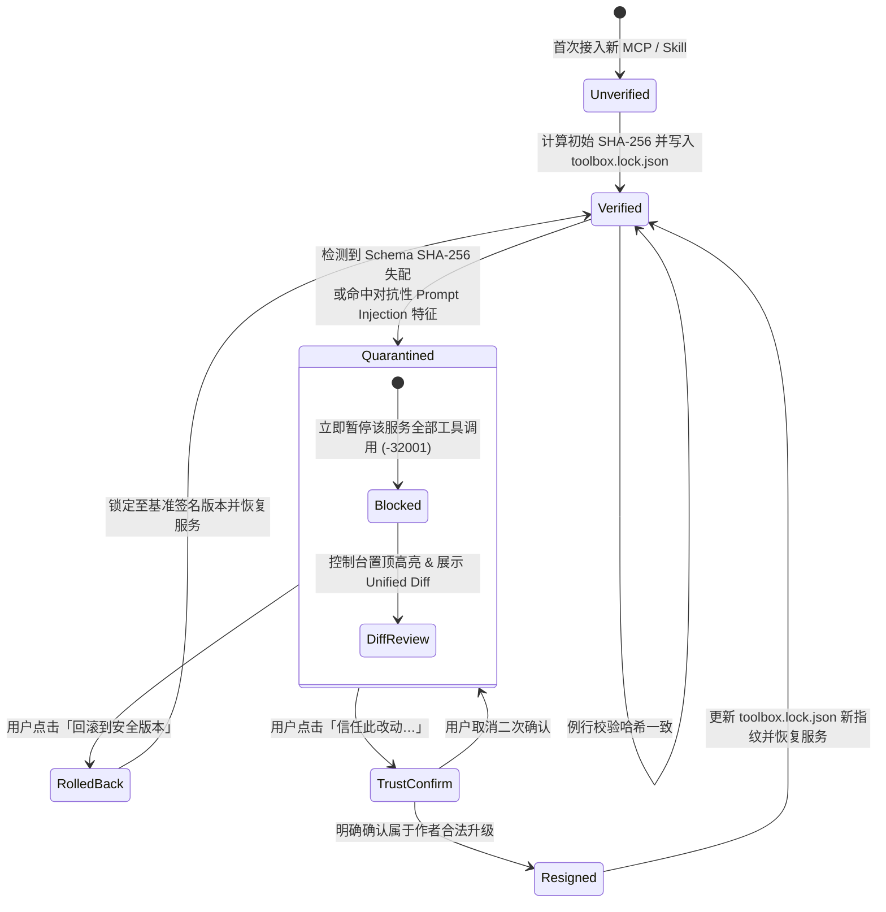
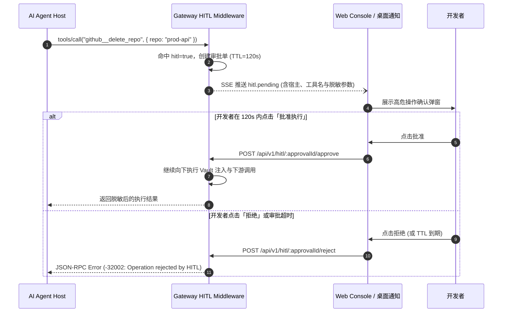
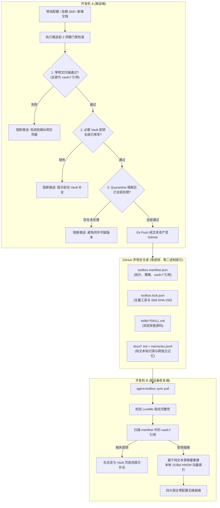

# Agent-Toolbox 安全威胁模型与 GitOps 同步设计

作为统领四大 AI Agent 宿主、外部 MCP 插件、本地密钥与私有知识库的**唯一控制平面**，Agent-Toolbox 遵循 **Fail-Closed（默认阻断）** 与 **Local-First Zero-Leakage（本地优先零泄漏）** 两大核心安全原则。

---

## 1. STRIDE 威胁建模与缓解矩阵

| 威胁类别 | 具体攻击场景（Agent-Toolbox 上下文） | 严重度 | 网关防御机制与工程落点 |
| :--- | :--- | :--- | :--- |
| **T1. 篡改 (Tampering)** | 第三方 MCP Server 通过 `npx -y` 静默更新，在 `description` 中注入隐蔽指令（如诱导读取 `~/.ssh/id_rsa`）实施 **Rug-Pull 提示词投毒** | **Critical** | `toolbox.lock.json` SHA-256 Schema 指纹强校验 + 对抗性关键词扫描 + **Quarantine 自动隔离区**（错误码 `-32001`） |
| **T2. 信息泄露 (Info Disclosure)** | 下游工具返回错误堆栈或配置内容时意外带出 `ghp_`、`sk-`、数据库 DSN 等真实密钥，被送入云端 LLM 上下文 | **Critical** | **04. Output Secret Redaction** 出站脱敏中间件，实时正则 + 高熵检测并替换为 `[REDACTED_BY_TOOLBOX]` |
| **T3. 凭据泄漏 (Secret Leak)** | 用户同步配置到 GitHub 私有/公开仓库时误提交明文 API Token | **Critical** | 强制 `vault://KEY_NAME` 符号引用 + 本地加密 Vault + **推送前 3 项硬门禁检查**（含明文正则阻断） |
| **T4. 权限提升 (EoP)** | 处于只读审计任务的 Agent（如 Codex CLI）意外调用破坏性工具（`github__delete_repo`、`postgres__drop_table`） | **High** | **Client Profile 权限作用域**（`full` / `audit` / `min`）+ 高危工具独立 **HITL 人工审批锁** |
| **T5. 拒绝服务 (DoS)** | 多宿主同时拉起大量重复子进程导致内存耗尽、向量库写锁死锁，或单轮工具调用触发 Token 预算爆炸 | **Medium** | 单守护进程连接池复用 + 串行写队列 + **05. Token 预算护栏** |
| **T6. 不可抵赖性 (Repudiation)** | 发生异常数据变更后无法追溯是哪个 AI 宿主在何时调用了哪个工具 | **Medium** | 全量 JSON-RPC 调用写入结构化 **Audit Log**（时间戳、宿主、工具名、结果态、耗时、脱敏后报文） |

---

## 2. Quarantine 防投毒隔离状态机

每次下游 MCP 连接初始化、周期心跳重检或加载 Skill 前，网关对规范化 Schema 计算 SHA-256 摘要，并执行对抗性模式扫描（检测如 `ignore previous instructions`、`~/.ssh`、`/etc/passwd`、`curl ... | sh`、`exfiltrate` 等高危注入特征）。



### 2.1 Canonical Schema 哈希算法规范

为避免 JSON 键顺序变化引发误报，所有指纹计算必须遵循统一规范化流水线：
1. 抽取参与签名的安全敏感字段：`{ name, description, inputSchema }`（排除运行态统计字段如 `latencyMs`、`callCount`）。
2. 对对象所有层级键按 UTF-8 字典序递归排序，去除非必要空白字符（RFC 8785 JCS 子集）。
3. 执行 `SHA-256` 摘要，Lockfile 中存储完整 64 位十六进制串，UI 展示前缀 + 前 6 位短码（如 `sha256:7d11e4`）。

---

## 3. HITL 人工审批与 Output Secret Redaction 设计

### 3.1 HITL（Human-in-the-Loop）高危审批时序

所有标记为 `hitl: true` 的高危写/删工具（默认包含 `github__delete_repo`、`postgres__drop_table` 等）在执行前强制进入人工审批挂起流：



### 3.2 Output Secret Redaction（出站敏感凭据自动脱敏）

在结果返回给任何宿主（及写入审计日志）前，出站中间件依次执行三层扫描并将命中片段替换为统一占位符 **`[REDACTED_BY_TOOLBOX]`**：

1. **Vault 精确回溯匹配**：对当前本地 Vault 中已配置的所有真实密钥值（长度 ≥ 8）进行字面量与 Base64/URL 编码变体匹配，杜绝已注入密钥在下游响应中被回显。
2. **已知高危前缀正则库**：
   - GitHub Token：`gh[pousr]_[A-Za-z0-9_]{20,}`
   - OpenAI / Anthropic / 云厂商 Key：`sk-[A-Za-z0-9\-_]{20,}`、`AKIA[0-9A-Z]{16}`
   - 数据库连接串：`(?:postgres(?:ql)?|mysql|mongodb(?:\+srv)?|redis):\/\/[^\s"'`]+`
   - 私钥块：`-----BEGIN (?:RSA |EC |OPENSSH )?PRIVATE KEY-----[\s\S]+?-----END .*?PRIVATE KEY-----`
3. **高香农熵敏感键过滤**：对 JSON 响应中键名包含 `secret`、`token`、`password`、`dsn`、`api_key`、`authorization` 且值熵值 > 3.8 的字符串自动脱敏。

---

## 4. Local-First Vault 密钥保险箱规范

- **命名规范**：密钥键名强制校验正则 `^[A-Z0-9_]+$`（如 `GITHUB_PERSONAL_TOKEN`、`POSTGRES_PROD_DSN`、`SLACK_BOT_TOKEN`）。
- **加密存储**：优先使用操作系统原生钥匙串（macOS Keychain / Windows Credential Manager / Linux Secret Service）；无原生服务时降级为本地加密文件 `~/.agent-toolbox/vault.enc`（文件权限 `0600`，`AES-256-GCM` + `scrypt` 主密钥派生）。
- **最小可见掩码规则**：
  - 长度 ≥ 10：`前 4 位 + "****" + 后 4 位`（例如 `ghp_****9a2f`、`post****:5432`）；
  - 长度 6–9：`前 2 位 + "****" + 后 2 位`；
  - 长度 < 6：固定显示 `******`。
- **绝对边界**：Web UI、REST API、SSE、Audit Log 与 GitHub 仓库**在任何场景下均不得输出明文密钥**。

---

## 5. GitHub GitOps 声明式同步与新设备恢复流程



### 5.1 仓库 `.gitignore` 强约束清单

所有由 Agent-Toolbox 初始化的同步仓库自动写入并校验以下忽略规则，双保险防止敏感或大体积文件误提交：

```gitignore
# 本地密钥与守护进程运行时文件（严禁提交）
vault.enc
*.key
.env
.env.*
daemon.lock

# 本地向量数据库二进制与缓存索引（由源文档增量重建）
vector.db
vector.db-*
lancedb/
*.hnsw
audit-logs/
```
